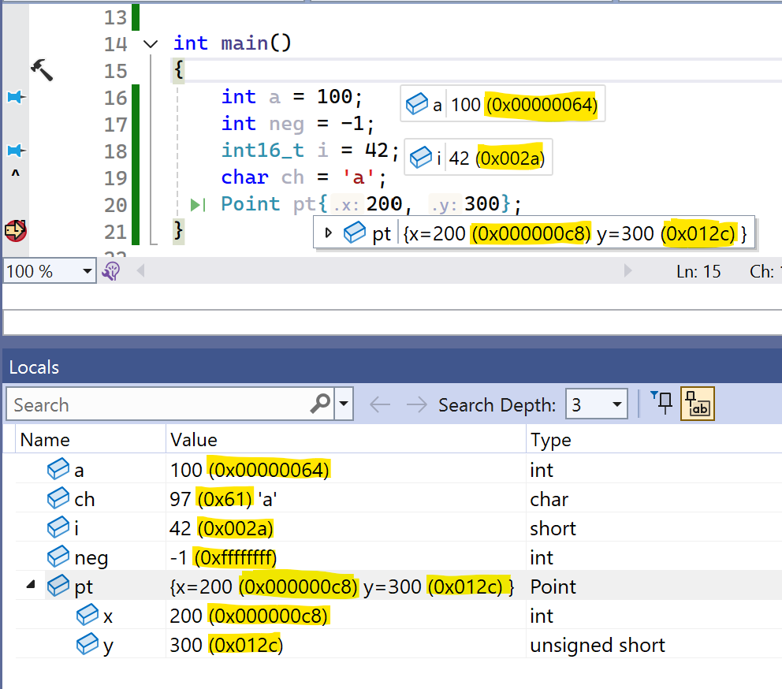

#          AlwaysHex - Visual Studio Extension

**Show variable values in decimal and hex together while you debug in Visual Studio.**

Visual Studio's debugger shows numbers either in decimal *or* in hex. Which one depends on the
*Hexadecimal Display* toggle, so you keep switching back and forth. AlwaysHex shows both:

| | Without AlwaysHex | With AlwaysHex |
|---|---|---|
| `int a = 100` | `100` | `100 (0x00000064)` |
| `int neg = -1` | `-1` | `-1 (0xffffffff)` |
| `int16_t i = 42` | `42` | `42 (0x002a)` |
| `char ch = 'a'` | `97 'a'` | `97 (0x61) 'a'` |
| `POINT pt` | `{x=1655 y=222}` | `{x=1655 (0x00000677) y=222 (0x000000de)}` |

The radix you picked with *Hexadecimal Display* always comes first. With hex display on,
`100` is shown as `0x00000064 (100)`.

## Where it works

- **Languages:** C and C++ (native code) and C#. C++/CLI is left exactly as Visual Studio shows it.
- **Windows:** data tips (hover), Watch, Locals, Autos, struct/class members, array elements,
  and the Call Stack window
- **Visual Studio:** 2022 and 2026, 64-bit.
  - **Tested:** Visual Studio 2022 17.14 (Community) and Visual Studio 2026 18.11 (Professional)
    with the full release tests; also used with Professional 2022.
  - **Installable but not tested:** the installer also accepts every other 2022 version (17.0 and
    later), other 2026 versions and the Enterprise edition. AlwaysHex relies on undocumented
    debugger behavior (see [How it works](#how-it-works)), so on an untested version values may
    show one radix only or an evaluation error.

There is nothing to configure: install it and start debugging.

**Copying a value:** *Copy Value* in the right-click menu copies both parts, for example
`100 (0x00000064)`. To copy only the first part, double-click the value and press Ctrl+C.

**Good to know:**

- C#: visualizer windows (IEnumerable, DataTable, …) show their contents in one radix.
- C#, remote debugging (Remote Tools): C# values are shown in one radix only, as without
  AlwaysHex.

## Installation

1. Download `AlwaysHex.vsix` from the [Releases](../../releases) page.
2. Close Visual Studio and double-click the file. The installer lists the Visual Studio
   versions it can install into.
3. Start Visual Studio and debug as usual.

To turn AlwaysHex off, disable it under **Extensions → Manage Extensions** and restart Visual Studio.

**Not active after an update in Visual Studio 2026?** After updating an already installed
AlwaysHex, Visual Studio 2026 sometimes keeps using its old extension cache and starts without
it. Close Visual Studio, open a *Developer Command Prompt for VS 2026* and run
`devenv /updateconfiguration` once.

## How it works

AlwaysHex consists of two components for the Visual Studio debug engine ("Concord"):

- **C/C++:** a component just above the built-in C/C++ expression evaluator, so every request
  for a value reaches it first. It asks the evaluator twice, once in your radix and once in the
  other one (without side effects), merges the two answers, `100` + `0x00000064` →
  `100 (0x00000064)`, and hands the result to Visual Studio.
- **C#:** a component just above the C# value formatter. When the formatter produces the text
  for an integer, AlwaysHex adds the other radix. Nothing else changes, so all C# debugger
  features (visualizers, Object IDs, …) keep working, and property getters never run twice.

The source code in [`AlwaysHex/AlwaysHexEvaluator.cs`](AlwaysHex/AlwaysHexEvaluator.cs) starts
with a detailed explanation, including the debugger terms it uses and the routing trick;
[`AlwaysHex/AlwaysHexClrFormatter.cs`](AlwaysHex/AlwaysHexClrFormatter.cs) is the C# part.

> [!WARNING]
>
> #### Undocumented Visual Studio behavior
>
> To pass requests on to the built-in C/C++ evaluator, AlwaysHex relies on how Visual Studio routes
> them internally. This routing is not documented by Microsoft. It is tested only with Visual Studio
> 2022 17.14 and Visual Studio 2026 18.11; other versions may behave differently, and a future
> version may need an update of AlwaysHex. If the routing changes, C/C++ values may show one radix
> only, look different, or show an evaluation error. AlwaysHex has guards that end a request which
> keeps coming back to it with an error instead of looping, but it cannot guarantee that Visual Studio
> or another debugger component it passes a request on to always answers.

## Building from source

See [BUILDING.md](BUILDING.md).

## Release tests

See [RELEASE_TESTS.md](RELEASE_TESTS.md): the test programs and scripts that check AlwaysHex in a
real Visual Studio, and how to run the full release test.

## AI usage

AlwaysHex was written by Claude (Claude Opus 5.5, an AI model by Anthropic), working in Claude
Code: the idea for how to hook into the debugger, the source code, the build and packaging setup,
the test programs and scripts, and most of this README.

OpenAI Codex (Astra) reviewed the extension’s source code for potential Visual Studio crashes, hangs, and incorrect variable displays; no defects were found.

I, Jochen, supervised the work: I described what I wanted, made the decisions (features,
name, license, supported Visual Studio versions) and tested the extension by hand, including in
real-world projects.

## License

[MIT](LICENSE) © 2026 Jochen Baier, email(at)jochen-baier.de
